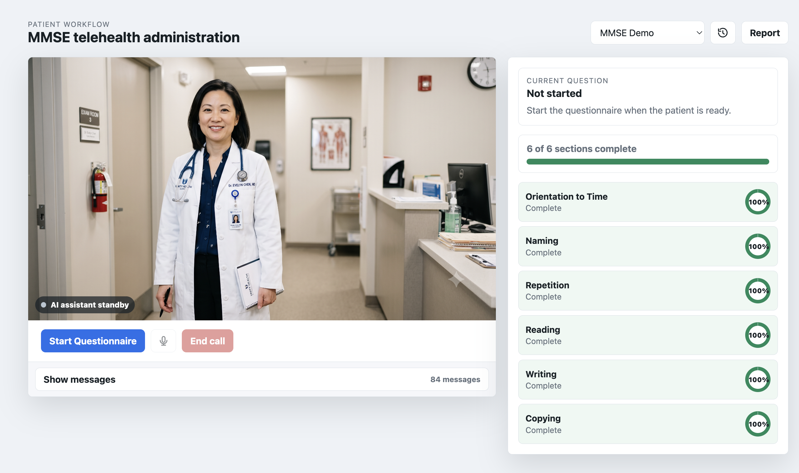
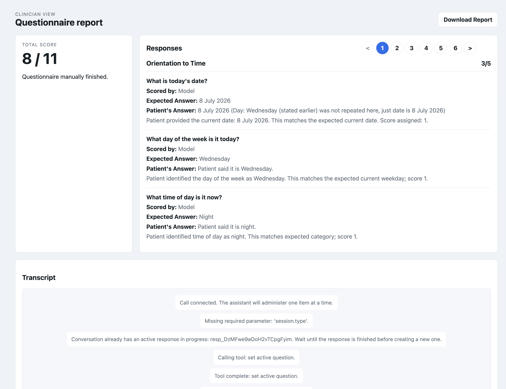
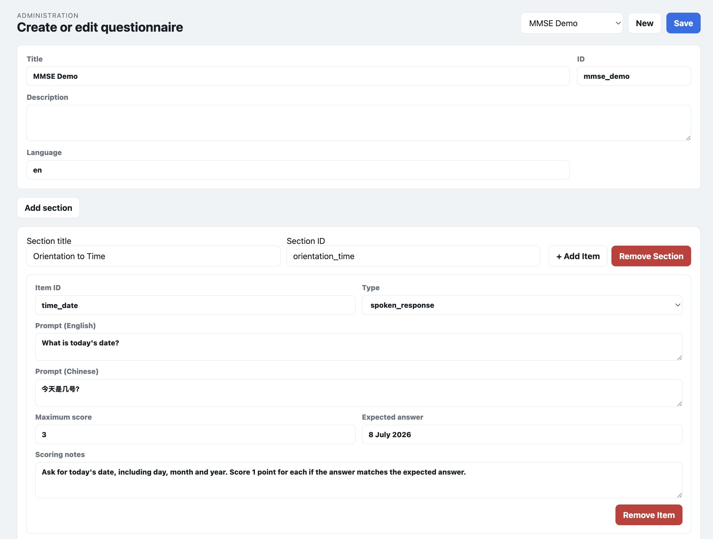

# CogniScreen

**CogniScreen administers medical questionnaires over an AI voice call using the OpenAI Realtime API.** 

Scenario: A patient joins a telehealth-style call, talks through one question at a time with an OpenAI Realtime voice assistant, uses camera and canvas tools for observation and drawing tasks, and a clinician reviews a scored report afterward. The bundled questionnaire is the Mini-Mental State Examination (MMSE).

**Team Name**: HEAL
- Adison Goh
- Jace Han
- Gary Ang

## Demo

#### Patient Voice Call
Live call with the AI assistant: current question, section progress, and transcript. Beyond voice: draw/observe tasks (here, copying intersecting pentagons).
 


#### Clinician report 
Total score, per-item scores, responses, and captured canvas/camera artifacts. Exports to PDF.


#### Admin editor 
Author any questionnaire with nested sections and per-item capabilities.


## How It Works

```text
Browser UI  ──HTTP + WebRTC SDP offer──▶  Node server  ──SDP + session config──▶  OpenAI Realtime API
public/                                    server.js                               gpt-realtime-2.1-mini
```

- The patient starts a voice session; the server brokers it via `POST /api/realtime/session`.
- The selected questionnaire is passed to the model as structured JSON. The model administers **one question at a time**, probes incomplete answers, and scores responses.
- Tool calls let the model set the active question, record scored answers, and finish the session. Tool outputs return progress so the model tracks what's left.
- Voice items use the audio conversation; reading/observation items use a webcam snapshot; writing/copying items use an interactive canvas. Submitted media appears in the clinician report.

## Features

- **Patient call** (`/`) — WebRTC voice session, AI avatar, live status, current-question card, section progress, and transcript.
- **Multimodal tasks** — voice, camera snapshot, and canvas (write/draw) items, including the MMSE pentagon-copying task.
- **Admin editor** (`/admin`) — create or edit questionnaires with nested sections and per-item capabilities (`voice`, `camera`, `canvas`, `reading`, `writing`, `copying`).
- **Clinician report** (`/report`) — total score, per-item scores, responses, scoring notes, transcript, media artifacts, and PDF export.
- **Dialogue log** (`/log`) — full session transcript for audit purposes.

## Setup

Prerequisites: **Node.js 20+** and an `OPENAI_API_KEY` with Realtime API access. No dependencies to install — the app uses only Node built-ins and browser APIs.

Copy `.env.example` to `.env.local` and fill in your key:

```bash
cp .env.example .env.local
```

```text
OPENAI_API_KEY=...
REALTIME_MODEL=gpt-realtime-2.1-mini                    # optional, this is the default
REALTIME_VOICE=marin                                    # optional, this is the default
REALTIME_TRANSCRIPTION_MODEL=gpt-4o-mini-transcribe      # optional, this is the default
OPENAI_SAFETY_IDENTIFIER=local-questionnaire-demo        # optional, this is the default

# Clinic identity used to score MMSE orientation-to-place items (all optional, default to Singapore)
CLINIC_STATE_OR_PROVINCE=Singapore
CLINIC_COUNTY_OR_DISTRICT=Singapore
CLINIC_CITY=Singapore
CLINIC_OR_HOSPITAL_NAME=Tan Tock Seng Hospital
CLINIC_FLOOR=3
```

The key is read from the process environment, then `.env`, then `.env.local`.

## Run

```bash
node server.js          # or: npm start
```

If port 3000 is taken, set another: `PORT=3001 node server.js`.

- Patient app: `http://localhost:3000/`
- Admin editor: `http://localhost:3000/admin`
- Clinician report: `http://localhost:3000/report`
- Dialogue log: `http://localhost:3000/log`
- Health check: `http://localhost:3000/health`

## Using The App

1. Open `/`, select a questionnaire, and click **Start Questionnaire**.
2. Allow microphone access, then speak naturally with the assistant.
3. When an item needs it, use the camera (**Start camera** → **Send snapshot**) or canvas (draw, then **Send canvas**).
4. Click **End call**, or let the assistant finish once all items are scored.
5. Review the scored report at `/report` and download the PDF.

## Data & API

The bundled questionnaire lives in `data/questionnaires.json` as a nested `sections → items` schema (`data/` holds local editable content). Key endpoints:

- `GET /health` — server status, configured model, and whether an API key was found.
- `GET /api/questionnaires` — all available questionnaires.
- `GET /api/session-context?questionnaireId=...` — clinic identity and current date facts used to build the model's Realtime instructions.
- `PUT /api/questionnaires/:id` — create or update a questionnaire.
- `POST /api/realtime/session?questionnaireId=...` — accepts a WebRTC SDP offer (`application/sdp`), creates a Realtime session, and returns the SDP answer.

## Key Files

- `server.js` — dependency-free Node HTTP server: static hosting, questionnaire API, Realtime session brokering.
- `public/app.js` — browser state machine: routing, WebRTC, Realtime events, tool-call handling, progress, camera, canvas, admin, report.
- `public/routes.js` — route table shared by client and server for page/static routing.
- `public/schema.js` — normalizes raw questionnaire JSON into the app's internal shape.
- `public/report.js` / `public/report-pdf.js` — clinician report data shaping and PDF export.
- `public/section-summary.js` — section progress and score aggregation.
- `public/index.html` / `public/styles.css` — single-page shell and clinical UI.
- `prompts/questionnaire-realtime.md` — system instructions for voice administration, probing, scoring, and tool behavior.
- `data/questionnaires.json` — questionnaire content.

## Verify

```bash
npm run check     # syntax-check server and public modules
npm test          # run the test suite
node server.js    # then confirm /health returns ok: true and /, /admin, /report, /log render cleanly
```

End-to-end Realtime testing requires browser microphone permission and a valid OpenAI API key.

## Safety Notes

- This app administers and records questionnaire responses. It does **not** diagnose, treat, or provide medical advice — reports must be reviewed by a qualified clinician.
- Local questionnaire edits and report state are not encrypted.
- This is a prototype: no authentication and no production persistence layer.
</content>
</invoke>
